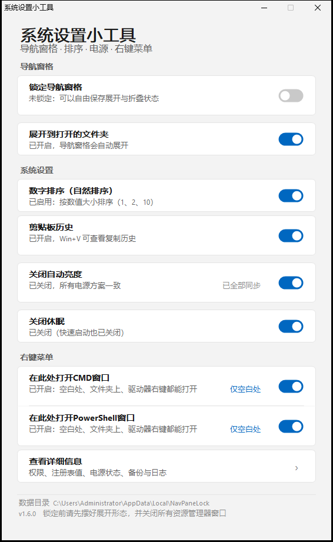

# 系统设置小工具

一个单文件 Windows 小工具，管理几项「平时要翻好几层设置才能改、还容易被系统改回去」的选项。
原生 Win32 窗口 + Win11 风格界面，自动跟随系统深浅色主题。


## 界面

```
导航窗格      锁定导航窗格（状态直接显示在副标题里）/ 展开到打开的文件夹
系统设置      数字排序 / 剪贴板历史 / 关闭自动亮度 / 关闭休眠 / 查看详细信息
右键菜单      在此处打开CMD窗口 / 在此处打开PowerShell窗口（各自独立开关）
```

点整行或点开关都能切换。操作进行中会弹出等待框，窗口不会假死。

「右键菜单」里的两条共用一张卡片，中间用一条细线分隔；其余每条设置各自独立成卡片。

锁定状态不单独占一块卡片，直接体现在「锁定导航窗格」这一行的副标题上：

- 绿色「已锁定：展开状态已冻结，重启后回到当前形态」
- 灰色「未锁定：可以自由保存展开与折叠状态」

## 各项功能

### 1. 锁定导航窗格

把资源管理器左侧导航栏的展开/折叠状态**冻结**在当前形态。

锁的不是注册表里的开关值，而是资源管理器保存展开状态的状态键：

```
HKCU\Software\Microsoft\Windows\CurrentVersion\Explorer\Modules\NavPane
```

这个键里只有一个 `ExpandedState`（二进制），专门记录哪些节点展开、哪些收起，不含其他设置。

「锁定」= 给这个键加一条针对当前用户的拒绝权限（`SetValue` + `Delete`）。资源管理器仍能读、能正常显示，但写不进去 —— 所以无论怎么折叠，重启后都回到锁定时的样子。

**使用顺序**：先摆好展开形态 → 关闭所有资源管理器窗口 → 打开开关。

### 2. 展开到打开的文件夹

对应「查看 → 导航窗格 → 展开到打开的文件夹」，写 `Advanced\NavPaneExpandToCurrentFolder`。

### 3. 数字排序

控制「文件2」和「文件10」谁在前：

| `NoStrCmpLogical` | 效果 | 顺序 |
|---|---|---|
| 未设置（默认） | 数字排序 | 文件1、文件2、文件10 |
| `0` | 数字排序 | 文件1、文件2、文件10 |
| `1` | 逐字符比较 | 文件1、文件10、文件2 |

位置：`HKLM\SOFTWARE\Microsoft\Windows\CurrentVersion\Policies\Explorer`。需要管理员，全机器生效。

### 4. 剪贴板历史

控制 Win+V 的剪贴板历史。

```
HKCU\Software\Microsoft\Clipboard\EnableClipboardHistory   (DWORD 1/0)
```

值不存在 = 系统默认（开启）。**写这个值不需要管理员。**

**服务检测**

剪贴板历史依赖每用户服务 `cbdhsvc_<哈希>`，以及它的模板 `cbdhsvc`。任何一个被禁用，开关拨了也不会生效，所以启动时会检测：

| 状态 | 界面 |
|---|---|
| 正常 | 副标题显示「已开启 / 已关闭」 |
| 服务被禁用 | 副标题变警示色「剪贴板服务被禁用，Win+V 不会生效」，行内出现「修复」链接 |
| 找不到服务 | 「未找到剪贴板服务，本机可能不支持该功能」 |

**「修复」** 会把模板和当前用户实例的启动类型都改回「手动」（需要管理员，机器范围）。

⚠️ 修复后**必须注销并重新登录**才生效 —— Windows 的剪贴板服务是 `USER_SHARE_PROCESS`，按用户会话启动，无法用 `sc start` 立即拉起（实测返回错误 1058）。

### 5. 关闭自动亮度

设置项 `fbd9aa66-9553-4097-ba44-ed6e9d65eab8`（显示 → 启用自适应亮度），写 AC/DC 索引。

**这一行的语义是「关闭」：开关打开 = 自动亮度已关闭。**

一行里放两件事：

| 控件 | 作用 |
|---|---|
| 开关 | 只改**正在使用**的电源方案 |
| 行内「同步到全部」 | 把当前状态复制到**所有**电源方案，之后切换方案也不会失效 |

状态是汇总显示：

- 所有方案一致 → 「已关闭，所有电源方案一致」，链接置灰显示「已全部同步」
- 有方案不一致 → 「当前已关闭，另有方案未同步（2 个开启）」，链接变成可点的「同步到全部」
- 如果当前其实是**开启**状态，同步前会确认一次（避免把其余方案全开起来）

⚠️ 需要**环境光传感器**才有实际效果。台式机、虚拟机通常没有，改了不会有可见变化，但设置本身会被正确写入。

### 6. 关闭休眠

**这一行的语义也是「关闭」：开关打开 = 休眠已关闭。**

| 开关动作 | 实际执行 | 副作用 |
|---|---|---|
| 打开（关闭休眠） | `powercfg /hibernate off` | 删除 `hiberfil.sys`，**同时关闭「快速启动」** |
| 关闭（恢复休眠） | `powercfg /hibernate on` | 重建 `hiberfil.sys`，约占内存 40%，并恢复快速启动 |

两个方向都会弹确认，因为各有代价。

开关只动休眠功能本身，**不碰睡眠/待机设置**。

### 7. 在此处打开CMD窗口 / 在此处打开PowerShell窗口

在资源管理器的右键菜单里加两条入口，两个**独立开关**，互不影响：

| 开关 | 菜单文案 | 动词名 |
|---|---|---|
| 在此处打开CMD窗口 | 在此处打开CMD窗口 | `NavPaneLockCmd` |
| 在此处打开PowerShell窗口 | 在此处打开PowerShell窗口 | `NavPaneLockPowershell` |



实现方式是注册**外壳动词（shell verb）** —— 纯注册表项，不需要 COM 扩展，也不需要额外的 DLL：

```
HKCU\Software\Classes\Directory\Background\shell\NavPaneLockCmd
    (默认)             = 在此处打开CMD窗口
    MUIVerb            = 在此处打开CMD窗口
    Icon               = C:\Windows\system32\cmd.exe
    NoWorkingDirectory = (空)
    command\(默认)     = cmd.exe /d /s /k pushd "%V"
```

两者的命令行语法完全不同，所以分开拼：

| | CMD | PowerShell |
|---|---|---|
| 程序 | `cmd.exe` | `System32\WindowsPowerShell\v1.0\powershell.exe`（Win10/11 自带的 5.1）|
| 保持窗口 | `/k` | `-NoExit` |
| 进目录 | `pushd "%V"` | `-Command "Set-Location -LiteralPath '%V'"` |
| UNC 网络路径 | ✅ pushd 自动映射临时盘符 | ✅ PowerShell 原生支持 UNC 位置 |
| 占位符 | 空白处 `%V`，对象 `%1` | 同左 |

两条命令的完整形态：

```
cmd.exe /d /s /k pushd "%V"
"C:\Windows\system32\WindowsPowerShell\v1.0\powershell.exe" -NoExit -Command "Set-Location -LiteralPath '%V'"
```

> ⚠️ **PowerShell 不能用 `-WorkingDirectory`** —— 实测 `powershell.exe` 接受这个参数、不报错，
> 却**不生效**（窗口还是停在原目录）。系统内置那条 `powershell.exe -noexit -WorkingDirectory "%V"`
> 就是这么写的，所以 Windows 自带的「在此处打开 Powershell 窗口」其实也没进到目标目录。
> 这里改用 `-Command "Set-Location -LiteralPath '...'"`，实测能正确进入。
>
> 路径用单引号包住：PowerShell 里单引号是字面量，不会做 `$变量` 展开。
> 代价是路径里带单引号（`'）时会失败 —— 极少遇到。

#### Win10 / Win11 通用做法

两版的右键菜单机制不一样，所以注册时守住三条：

| 做法 | 原因 |
|---|---|
| **不设 `Extended`** | 设了 Win10 要按 Shift 才出现、Win11 新菜单里直接不显示 |
| **不设 `Show/HideBasedOnVelocityId`** | 保持 Git for Windows 的形态，两版都直接显示 |
| **写可执行文件绝对路径** | 不依赖 PATH，32/64 位、系统装在别的盘都一致 |

本机实测，内置的两条系统项策略正好相反：

| 内置项 | Win10 | Win11 |
|---|---|---|
| `Directory\Background\shell\cmd` | `Extended` → 要按 Shift | `HideBasedOnVelocityId` → 新菜单看不见 |
| `Directory\Background\shell\Powershell` | `Extended` → 要按 Shift | `ShowBasedOnVelocityId` → 新菜单看得见 |

所以：

- **CMD**：Win11 上系统那条本来就藏着，我们这条是唯一入口。
- **PowerShell**：Win11 上系统自带一条「在此处打开 **Powershell** 窗口」（注意是小写 s），
  开启本开关后会**并存两条**，靠文案区分。我们不覆盖系统键。

#### 作用范围

每个开关旁边各有一个链接，**互不影响**：「仅空白处」/「全部位置」。

| 位置 | 注册表路径 | 占位符 |
|---|---|---|
| 文件夹空白处 | `Directory\Background\shell` | `%V`（当前所在目录） |
| 文件夹本身 | `Directory\shell` | `%1`（被点中的文件夹） |
| 驱动器盘符 | `Drive\shell` | `%1`（盘符根目录） |

写完立刻调用 `SHChangeNotify(SHCNE_ASSOCCHANGED)`，Explorer 随即重建菜单，**不用重启资源管理器**。

作用范围的偏好记在 `HKCU\Software\NavPaneLock`（`ScopeCmd` / `ScopePs`），关掉开关再打开也记得上次选的是哪一档。

关闭开关 = 删掉对应 `shell` 子树，干净回退，不留残项。

## 权限

| 功能 | 需要管理员 |
|---|---|
| 锁定 / 展开 / 剪贴板历史开关 / 查看详细信息 | 否 |
| 数字排序 / 自适应亮度 / 休眠 / 剪贴板服务修复 | 是 |
| 在此处打开CMD窗口 / 在此处打开PowerShell窗口 | 否（只写当前用户的 `HKCU\Software\Classes`） |

系统级设置采用**按需提权**：程序平时以普通权限启动、不弹 UAC，只有拨动系统设置开关时才启动一个提权实例执行写入，写完即退。

如果 UAC 被取消，会提示「已取消」，不会误报失败。

> ⚠️ 不要把 exe 放在沙箱或受控目录里运行。如果提示「当前进程无法写入 HKEY_CURRENT_USER」，说明进程被外部策略限制了，跟注册表权限无关，提权也没用 —— 把 exe 复制到桌面或任意普通目录再运行。「查看详细信息」里的「注册表可写」一行可以直接判断。

## 其他行为

- **单实例**：重复启动会提示已在运行，避免两个进程同时改同一份权限
- **权限备份**：每次锁定前存一份 SDDL，只保留最近 10 份
- **操作日志**：`actions.log`，超过 512 KB 自动轮转一份
- **数据目录**：`%LOCALAPPDATA%\NavPaneLock\`

## 跨版本说明

在 Windows 10 / 11 上通用：

- 电源方案 GUID **不硬编码**，运行时用 `PowerEnumerate` 枚举
- 不解析 `powercfg` 的输出文字（它是本地化的），一律只看退出码与回读状态
- 电源设置、休眠值读不到时降级显示为「此设备不支持」，不会崩溃

## 编译

需要 Windows 自带的 .NET Framework 4.x，不需要 SDK：

```cmd
build.cmd
```

源码：

| 文件 | 内容 |
|---|---|
| `App.cs` | 程序入口、单实例、提权子命令 |
| `NavPaneCore.cs` | 导航窗格 / 数字排序 / 权限 |
| `PowerCore.cs` | 自适应亮度 / 休眠 |
| `ClipboardCore.cs` | 剪贴板历史 / 服务检测与修复 |
| `ContextMenuCore.cs` | 右键菜单 shell verb 的注册与注销 |
| `Gui.cs` | 界面（主题、控件、对话框） |

## 已验证

Windows 11 build 26300（.NET Framework 4.8.1）：

- 锁定后其他进程写入被拒（`ERROR_ACCESS_DENIED`），解锁后 ACL 与原快照**逐字节一致**（6 → 7 → 6）
- 权限丢失的自修复、旧脚本规则的识别与移除
- 数字排序：`CompareIDs(a2, a10)` 实测三种状态（未设置 / 0 / 1）顺序正确翻转
- 自适应亮度：当前方案 `0 → 1 → 0`；点「同步到全部」后 4 个方案全部写入（1/4 不同步 → 4/4 一致）
- 休眠：`1 → 0` 往返，`HibernateEnabled` 与 `hiberfil.sys`（3.4 GB）都符合预期
- 剪贴板历史：`1 → 0 → 1` 写入与回读一致；服务修复把模板与实例从「禁用」改回「手动」并回读确认
- 右键菜单：两个入口各自三处注册项逐值回读一致（`MUIVerb` / `Icon` / `NoWorkingDirectory` / `command`），
  图标也跟着走（cmd.exe / powershell.exe），缩到「仅空白处」时另两处被删干净，注销后所有子树无残留
- 两个入口互相独立：只关 PowerShell 不影响 CMD 的注册项
- 右键菜单命令：把注册表里那条命令**原样**取出、替换 `%V` 后用 `CreateProcess` 逐字执行
  （和 Explorer 右键时的下发方式一致）：
  - CMD 落在 `D:\Source\NavPaneLock`，提示符显示 `D:\Source\NavPaneLock>`
  - 路径故意填成不存在的目录时，cmd 报「The system cannot find the path specified.」
  - PowerShell 进程保持运行（`-NoExit` 生效），路径不存在时给出 Set-Location 报错
  - 另测过含空格、中文、括号的路径，pushd / Set-Location 均正确落点
- 作用范围偏好持久化在 `HKCU\Software\NavPaneLock`（`ScopeCmd` / `ScopePs`），读写一致
- 界面：浅色/深色两套主题、服务被禁用时的警示态均截图核对

未覆盖：

- Windows 10 实机完整回归（剪贴板历史的值名与路径在 1809+ 与 Win11 一致，未实机验证）
- 无环境光传感器的机器上自适应亮度的实际视觉效果
- 标准账户下的 UAC 提权流程
- **右键菜单的实际观感**：注册项、命令行为都已验证，但没有在 Explorer 里真的右键点过那两条菜单项 —— 需要人工确认一下它们落在新版菜单的哪个位置
- **Windows 10 实机**：注册项的写法（不设 `Extended`、不设 velocity id）是按两版通用原则设计的，但只在 Win11 上实机验证过，Win10 上没验过
- **Win+V 的实际行为**：本机镜像把 `cbdhsvc` 模板禁用了，且 `USER_SHARE_PROCESS` 无法手动启动（错误 1058），需要注销重登才能验证 —— 因此「关闭后历史是否被清空」这一点也未实测，界面上的确认文案只描述「不再显示历史」这一确定效果
