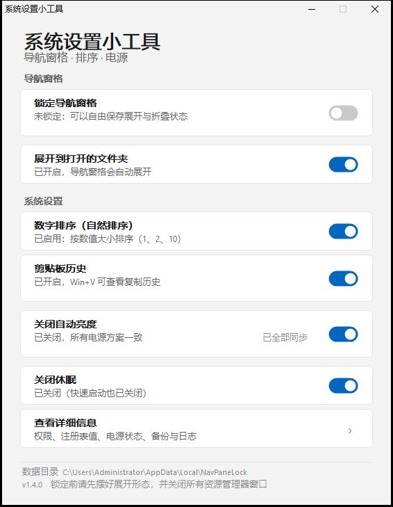

# 系统设置小工具

一个单文件 Windows 小工具，管理几项「平时要翻好几层设置才能改、还容易被系统改回去」的选项。
原生 Win32 窗口 + Win11 风格界面，自动跟随系统深浅色主题。



## 界面

```
导航窗格      锁定导航窗格（状态直接显示在副标题里）/ 展开到打开的文件夹
系统设置      数字排序 / 剪贴板历史 / 关闭自动亮度 / 关闭休眠 / 查看详细信息
```

点整行或点开关都能切换。操作进行中会弹出等待框，窗口不会假死。

锁定状态不单独占一块卡片，直接体现在「锁定导航窗格」这一行的副标题上：

- 绿色「已锁定：展开状态已冻结，重启后回到当前形态」
- 灰色「未锁定：可以自由保存展开与折叠状态」

## 各项功能

### 1. 锁定导航窗格

把资源管理器左侧导航栏的展开/折叠状态**冻结**在当前形态。

锁的不是注册表里的开关值，而是资源管理器保存展开状态的状态键：

```
HKCU\Software\Microsoft\Windows\CurrentVersion\Explorer\Modules\NavPane
```

这个键里只有一个 `ExpandedState`（二进制），专门记录哪些节点展开、哪些收起，不含其他设置。

「锁定」= 给这个键加一条针对当前用户的拒绝权限（`SetValue` + `Delete`）。资源管理器仍能读、能正常显示，但写不进去 —— 所以无论怎么折叠，重启后都回到锁定时的样子。

**使用顺序**：先摆好展开形态 → 关闭所有资源管理器窗口 → 打开开关。

### 2. 展开到打开的文件夹

对应「查看 → 导航窗格 → 展开到打开的文件夹」，写 `Advanced\NavPaneExpandToCurrentFolder`。

### 3. 数字排序

控制「文件2」和「文件10」谁在前：

| `NoStrCmpLogical` | 效果 | 顺序 |
|---|---|---|
| 未设置（默认） | 数字排序 | 文件1、文件2、文件10 |
| `0` | 数字排序 | 文件1、文件2、文件10 |
| `1` | 逐字符比较 | 文件1、文件10、文件2 |

位置：`HKLM\SOFTWARE\Microsoft\Windows\CurrentVersion\Policies\Explorer`。需要管理员，全机器生效。

### 4. 剪贴板历史

控制 Win+V 的剪贴板历史。

```
HKCU\Software\Microsoft\Clipboard\EnableClipboardHistory   (DWORD 1/0)
```

值不存在 = 系统默认（开启）。**写这个值不需要管理员。**

**服务检测**

剪贴板历史依赖每用户服务 `cbdhsvc_<哈希>`，以及它的模板 `cbdhsvc`。任何一个被禁用，开关拨了也不会生效，所以启动时会检测：

| 状态 | 界面 |
|---|---|
| 正常 | 副标题显示「已开启 / 已关闭」 |
| 服务被禁用 | 副标题变警示色「剪贴板服务被禁用，Win+V 不会生效」，行内出现「修复」链接 |
| 找不到服务 | 「未找到剪贴板服务，本机可能不支持该功能」 |

**「修复」** 会把模板和当前用户实例的启动类型都改回「手动」（需要管理员，机器范围）。

⚠️ 修复后**必须注销并重新登录**才生效 —— Windows 的剪贴板服务是 `USER_SHARE_PROCESS`，按用户会话启动，无法用 `sc start` 立即拉起（实测返回错误 1058）。

### 5. 关闭自动亮度

设置项 `fbd9aa66-9553-4097-ba44-ed6e9d65eab8`（显示 → 启用自适应亮度），写 AC/DC 索引。

**这一行的语义是「关闭」：开关打开 = 自动亮度已关闭。**

一行里放两件事：

| 控件 | 作用 |
|---|---|
| 开关 | 只改**正在使用**的电源方案 |
| 行内「同步到全部」 | 把当前状态复制到**所有**电源方案，之后切换方案也不会失效 |

状态是汇总显示：

- 所有方案一致 → 「已关闭，所有电源方案一致」，链接置灰显示「已全部同步」
- 有方案不一致 → 「当前已关闭，另有方案未同步（2 个开启）」，链接变成可点的「同步到全部」
- 如果当前其实是**开启**状态，同步前会确认一次（避免把其余方案全开起来）

⚠️ 需要**环境光传感器**才有实际效果。台式机、虚拟机通常没有，改了不会有可见变化，但设置本身会被正确写入。

### 6. 关闭休眠

**这一行的语义也是「关闭」：开关打开 = 休眠已关闭。**

| 开关动作 | 实际执行 | 副作用 |
|---|---|---|
| 打开（关闭休眠） | `powercfg /hibernate off` | 删除 `hiberfil.sys`，**同时关闭「快速启动」** |
| 关闭（恢复休眠） | `powercfg /hibernate on` | 重建 `hiberfil.sys`，约占内存 40%，并恢复快速启动 |

两个方向都会弹确认，因为各有代价。

开关只动休眠功能本身，**不碰睡眠/待机设置**。

## 权限

| 功能 | 需要管理员 |
|---|---|
| 锁定 / 展开 / 剪贴板历史开关 / 查看详细信息 | 否 |
| 数字排序 / 自适应亮度 / 休眠 / 剪贴板服务修复 | 是 |

系统级设置采用**按需提权**：程序平时以普通权限启动、不弹 UAC，只有拨动系统设置开关时才启动一个提权实例执行写入，写完即退。

如果 UAC 被取消，会提示「已取消」，不会误报失败。

> ⚠️ 不要把 exe 放在沙箱或受控目录里运行。如果提示「当前进程无法写入 HKEY_CURRENT_USER」，说明进程被外部策略限制了，跟注册表权限无关，提权也没用 —— 把 exe 复制到桌面或任意普通目录再运行。「查看详细信息」里的「注册表可写」一行可以直接判断。

## 其他行为

- **单实例**：重复启动会提示已在运行，避免两个进程同时改同一份权限
- **权限备份**：每次锁定前存一份 SDDL，只保留最近 10 份
- **操作日志**：`actions.log`，超过 512 KB 自动轮转一份
- **数据目录**：`%LOCALAPPDATA%\NavPaneLock\`

## 跨版本说明

在 Windows 10 / 11 上通用：

- 电源方案 GUID **不硬编码**，运行时用 `PowerEnumerate` 枚举
- 不解析 `powercfg` 的输出文字（它是本地化的），一律只看退出码与回读状态
- 电源设置、休眠值读不到时降级显示为「此设备不支持」，不会崩溃

## 编译

需要 Windows 自带的 .NET Framework 4.x，不需要 SDK：

```cmd
build.cmd
```

源码：

| 文件 | 内容 |
|---|---|
| `App.cs` | 程序入口、单实例、提权子命令 |
| `NavPaneCore.cs` | 导航窗格 / 数字排序 / 权限 |
| `PowerCore.cs` | 自适应亮度 / 休眠 |
| `ClipboardCore.cs` | 剪贴板历史 / 服务检测与修复 |
| `Gui.cs` | 界面（主题、控件、对话框） |

## 已验证

Windows 11 build 26300（.NET Framework 4.8.1）：

- 锁定后其他进程写入被拒（`ERROR_ACCESS_DENIED`），解锁后 ACL 与原快照**逐字节一致**（6 → 7 → 6）
- 权限丢失的自修复、旧脚本规则的识别与移除
- 数字排序：`CompareIDs(a2, a10)` 实测三种状态（未设置 / 0 / 1）顺序正确翻转
- 自适应亮度：当前方案 `0 → 1 → 0`；点「同步到全部」后 4 个方案全部写入（1/4 不同步 → 4/4 一致）
- 休眠：`1 → 0` 往返，`HibernateEnabled` 与 `hiberfil.sys`（3.4 GB）都符合预期
- 剪贴板历史：`1 → 0 → 1` 写入与回读一致；服务修复把模板与实例从「禁用」改回「手动」并回读确认
- 界面：浅色/深色两套主题、服务被禁用时的警示态均截图核对

未覆盖：

- Windows 10 实机完整回归（剪贴板历史的值名与路径在 1809+ 与 Win11 一致，未实机验证）
- 无环境光传感器的机器上自适应亮度的实际视觉效果
- 标准账户下的 UAC 提权流程
- **Win+V 的实际行为**：本机镜像把 `cbdhsvc` 模板禁用了，且 `USER_SHARE_PROCESS` 无法手动启动（错误 1058），需要注销重登才能验证 —— 因此「关闭后历史是否被清空」这一点也未实测，界面上的确认文案只描述「不再显示历史」这一确定效果
